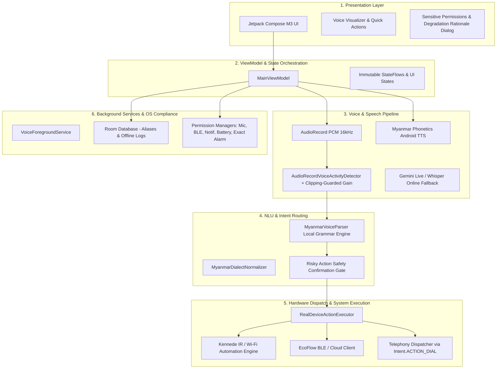

# Kyaw Gyi System Architecture Blueprint

## Six-Layer Architecture Overview

### Telephony & Contact Calling Architecture (ACTION_DIAL Honesty)
- **Safe Intent Execution**: Telephony requests are executed exclusively using `Intent.ACTION_DIAL` with `tel:` URI.
- **No Direct Calls**: The system never uses `Intent.ACTION_CALL`. Rather than silently placing unmonitored calls, it safely opens the Android system dialer pre-populated with the resolved contact number, granting the user full visual verification and final call control.
- **Burmese Feedback**: Once dispatched, the user receives affirmative Burmese audio and UI feedback: `"ဖုန်းခေါ်ဆိုရန် ဖုန်းခေါ်စနစ် ဖွင့်လှစ်ပြီးပါပြီ"`.

### Audio Signal Processing (Clipping-Guarded Normalization)
- **Pre-Amp Gain**: Audio frames in `AudioRecordVoiceActivityDetector` apply a +6dB (+2.0f) gain normalization.
- **Clamping**: Every sample is strictly bounded within `[Short.MIN_VALUE, Short.MAX_VALUE]` using `coerceIn` prior to integer conversion, preventing digital arithmetic overflow and audio clipping distortion.

### Sensitive Permission Architecture & Graceful Fallbacks
- All 5 critical Android system permissions (Microphone, Bluetooth/BLE, Notifications, Battery Optimization Exemption, Exact Alarm) maintain dedicated managers with:
  1. Clear Burmese rationales (`MYANMAR_RATIONALE`) explaining the functional benefit.
  2. Non-blocking graceful degraded fallbacks (`MYANMAR_DENIED_FALLBACK`) ensuring the application remains operational via manual on-screen controls, EcoFlow Cloud, or standard non-exact alarms when permissions are denied.

### Canonical Kotlin Package Tree & Module Organization

The codebase organizes Kotlin source files across three distinct package hierarchies:

1. **`com.kyawgyi.ir.*` — Canonical Implementations (The Real Source of Truth)**
   - Houses the core, production implementations of all Kyaw Gyi voice, IR, security, and hardware subsystems.
   - Key packages:
     - `com.kyawgyi.ir.voice.*`: Central audio capture, wake-word detection, speech engines, and Myanmar grammar parsing.
     - `com.kyawgyi.ir.service.*`: Foreground services (e.g., `VoiceForegroundService`) and background execution.
     - `com.kyawgyi.ir.db.*`: Room database entities, DAOs, and offline persistence.
     - `com.kyawgyi.ir.permissions.*`: Dedicated permission managers with Burmese rationales and non-blocking graceful fallbacks.
     - `com.kyawgyi.ir.repository.*` & `com.kyawgyi.ir.network.*`: Repositories and network communication clients.
     - `com.kyawgyi.ir.apikey.*`: Secure API key storage and encryption.
     - `com.kyawgyi.ir.ui.*`: UI screens, theme, and components.
     - `com.kyawgyi.ir.model.*` / `models.*`: Primary IR data schemas and device models.

2. **`com.example.*` — Shims & Typealiases (Compatibility Wrappers)**
   - Provides backward-compatible bridges, typealiases, and wrapper endpoints to maintain compatibility with existing references and platform tooling without breaking compilation.
   - Delegates directly to canonical counterparts in `com.kyawgyi.ir.*` or `com.aiangel.assistant.*`.

3. **`com.aiangel.assistant.*` — EcoFlow Client & IR Action Executor (Read-Only)**
   - Specialized hardware subsystem responsible for smart power management and device action dispatch.
   - Key components:
     - `com.aiangel.assistant.hardware.ecoflow.*`: `EcoFlowApiClient` and `EcoFlowSigner` for EcoFlow cloud/BLE power metrics and smart telemetry. (Read-only integration — do not modify EcoFlow code).
     - `com.aiangel.assistant.hardware.*`: `RealDeviceActionExecutor` and `IrCodeImporter` for dispatching physical actions and KENNEDE KN-5996HRB IR commands.
     - `com.aiangel.assistant.nlu.*`: Secondary intent recognition and parsed intent models.
     - `com.aiangel.assistant.data.*`: Offline assistant history and cache entities.

